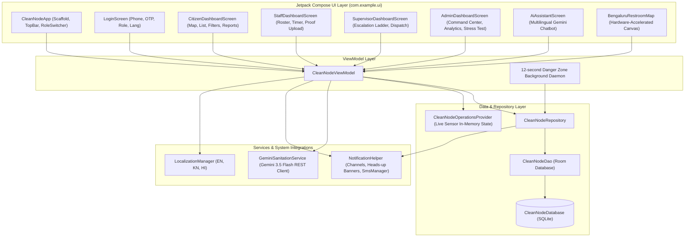

# CleanNode Architecture & Technical Specification

## 1. System Overview & Component Diagram

CleanNode utilizes an offline-first **Model-View-ViewModel (MVVM)** pattern combined with reactive Kotlin `Flow` streams, local Room database caching, background dispatch engine, and direct REST integrations with Google Gemini AI.



---

## 2. Layered Architecture Details

### 2.1 UI Layer (`com.example.ui`)
* **State Ingestion:** All screens consume state via `collectAsStateWithLifecycle()` from `CleanNodeViewModel`.
* **Zero-Recompose Subtrees:** Stateless composable items with granular lambdas minimize unnecessary recompositions.
* **Canvas Mapping (`BengaluruRestroomMap`):**
  * Hardware-accelerated custom Canvas drawing arterial corridors (Outer Ring Road, Hosur Rd, MG Rd, etc.).
  * Pulsating user GPS radar wave using `rememberInfiniteTransition`.
  * Dynamic restroom pins color-coded by PCI band:
    * `CleanGreen` (`#2E7D32`): Clean (80–100)
    * `ModerateYellow` (`#FBC02D`): Moderate (50–79)
    * `Orange` (`#F57C00`): Needs Attention (30–49)
    * `DangerRed` (`#BA1A1A`): Danger Zone (<30)
    * `Grey` (`#9E9E9E`): Unmonitored Private Restroom
  * Gesture detection: drag-to-pan, tap-to-select, and direct Android `Intent(Intent.ACTION_VIEW, Uri.parse("geo:..."))` dispatch for turn-by-turn navigation.

### 2.2 ViewModel Layer (`CleanNodeViewModel.kt`)
* **Dispatcher Scope:** Orchestrates coroutines on `viewModelScope` (cancelling work cleanly if ViewModel is destroyed).
* **Automated Dispatch Loop:**
  ```kotlin
  viewModelScope.launch {
      while (true) {
          try {
              repository.checkAndAutoDispatchDangerZoneDuties(getApplication())
          } catch (_: Exception) {}
          delay(12000L) // Scans every 12 seconds
      }
  }
  ```
* **Dynamic OTP Security Engine:** Dynamically generates random 6-digit cryptographic security codes (`(100000..999999).random()`), transmits them via `NotificationHelper`, and supports automatic verification.

### 2.3 Data & Repository Layer (`com.example.data`)
* **`CleanNodeRepository`:**
  * Coordinates database reads and writes.
  * Implements `smartRankedFacilities` Flow: sorts by distance, then applies a 50m proximity window to favor facilities with $>10$ PCI advantage.
  * Manages the lifecycle of `CleaningDutyEntity` and `EscalationEntity`.
* **`CleanNodeDatabase`:**
  * Room database v2 with type converters (`Converters.kt`) for Enums (`UserRole`, `AppLanguage`, `CleanlinessBand`, `DutyStatus`, `EscalationStage`, `ReportCategory`).
  * Seeds realistic Bengaluru public facilities across South Zone (Jayanagar), Central Zone (Cubbon Park, Majestic), and East Zone (Whitefield).
* **`CleanNodeOperationsProvider`:**
  * Supplies high-resolution cubicle-level live sensor feeds, threshold alerts, predictive maintenance risk factors, and maintenance history.

### 2.4 AI Integration Layer (`GeminiSanitationService.kt`)
* **Target Model:** `gemini-3.5-flash`
* **Direct REST Architecture:** Calls `https://generativelanguage.googleapis.com/v1beta/models/gemini-3.5-flash:generateContent?key=...` via an optimized `OkHttpClient` instance (30s connect/read timeouts).
* **Graceful Degradation:** When no API key is configured or offline, the service provides specialized domain heuristic responses in English, Kannada, and Hindi.
* **Three Primary AI Functions:**
  1. `explainPciScore()`: Ingests ammonia, humidity, occupancy, and flush flow to provide a 3-point diagnostic report (Root Cause, Required Action, Plumbing Status).
  2. `askSanitationAssistant()`: Conversational assistant answering citizen hygiene, location, and sanitation questions.
  3. `verifyCleaningProof()`: Evaluates completion of 5 hygiene parameters and awards an AI hygiene validation score (85–99).

### 2.5 Notification & Telecom Layer (`NotificationHelper.kt`)
* **Notification Channels:**
  * `cleannode_alerts`: High importance, vibration enabled for Danger Zone alerts.
  * `cleannode_otp`: High importance for OTP security codes.
  * `cleannode_dispatch`: High importance for staff duty assignments and supervisor escalations.
* **Telephony (`SmsManager`):** Real SMS dispatch via `SmsManager.getDefault()` or `context.getSystemService(SmsManager::class.java)`, with graceful logging fallback if SMS permissions are withheld.
